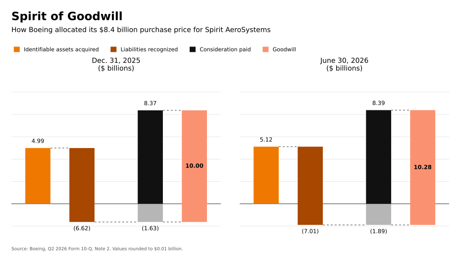

*Originally shared on [LinkedIn](https://www.linkedin.com/posts/iangow_very-nice-article-by-jonathan-weil-but-i-share-7501442346006261760-7kec/).*

::: {.content-visible when-format="html"}
[Download the PDF](spirit-of-goodwill.pdf).
:::

Very nice [article by Jonathan Weil](https://www.wsj.com/business/boeings-8-4-billion-deal-is-bleeding-red-ink-6a7bfb69), but I feel the included chart doesn't do a good job of conveying the relationships between the numbers.
Using AI (it needed a good deal of coaxing), I made a (hopefully) better version.

The chart below is an updated version, drawn with Matplotlib.

{fig-alt="Two waterfall charts of Boeing's preliminary purchase price allocation for Spirit AeroSystems. For December 31, 2025, identifiable assets of 4.99 less liabilities of 6.62 give net liabilities of 1.63; consideration of 8.37 implies goodwill of 10.00. For June 30, 2026, identifiable assets of 5.12 less liabilities of 7.01 give net liabilities of 1.89; consideration of 8.39 implies goodwill of 10.28. All amounts are US dollars in billions, rounded independently from the reported millions."}

Source: [Boeing's second-quarter 2026 Form 10-Q, Note 2](https://www.sec.gov/Archives/edgar/data/12927/000162828026050038/ba-20260630.htm).
The figures for 2025 also agree with [Note 2 of Boeing's 2025 Form 10-K](https://www.sec.gov/Archives/edgar/data/12927/000162828026004357/ba-20251231.htm).

::: {.content-visible when-format="html"}
[View the chart at full size](images/boeing-spirit-goodwill.svg).
:::
