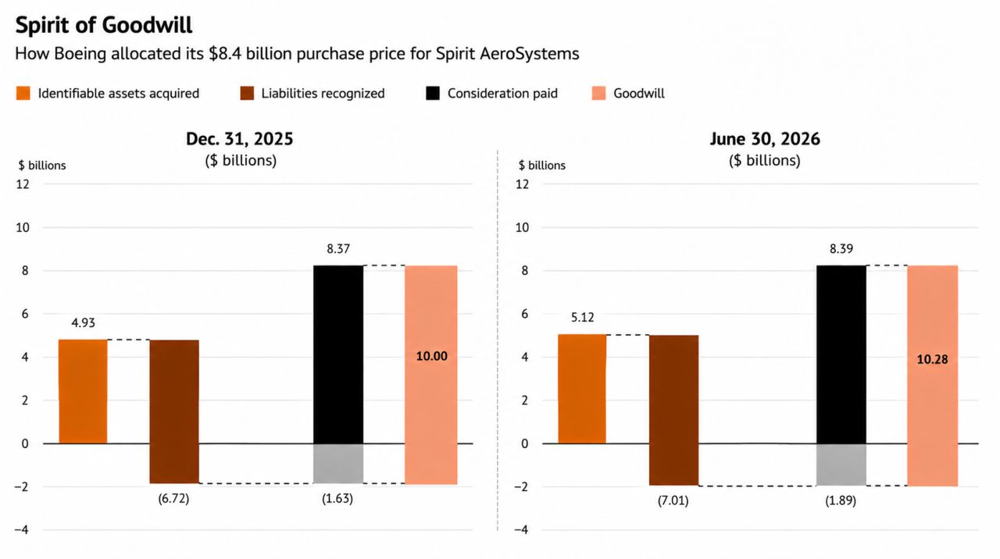

*Originally shared on [LinkedIn](https://www.linkedin.com/posts/iangow_very-nice-article-by-jonathan-weil-but-i-share-7501442346006261760-7kec/).*

::: {.content-visible when-format="html"}
[Download the PDF](spirit-of-goodwill.pdf).
:::

Very nice [article by Jonathan Weil](https://www.wsj.com/business/boeings-8-4-billion-deal-is-bleeding-red-ink-6a7bfb69), but I feel the included chart doesn't do a good job of conveying the relationships between the numbers.
Using AI (it needed a good deal of coaxing), I made a (hopefully) better version.

{fig-alt="Two waterfall charts showing Boeing's allocation of the purchase price for Spirit AeroSystems at December 31, 2025 and June 30, 2026. The charts compare identifiable assets, liabilities, consideration paid, and goodwill."}

::: {.content-visible when-format="html"}
[View the chart at full size](images/boeing-spirit-goodwill.jpg).
:::

In a [follow-up comment on the original post](https://www.linkedin.com/posts/iangow_very-nice-article-by-jonathan-weil-but-i-share-7501442346006261760-7kec/), I added on 10 September 2026:

> Looking at this again, I should probably lose the y-axis labels (they aren't adding anything).

::: {.callout-warning title="Migration review note"}
This check was added during migration and was not part of the LinkedIn post: in the left panel, $4.93 - 6.72 = -1.79$, whereas the grey bar is labelled $-1.63$.
The original chart is retained here while this discrepancy is checked.
:::
