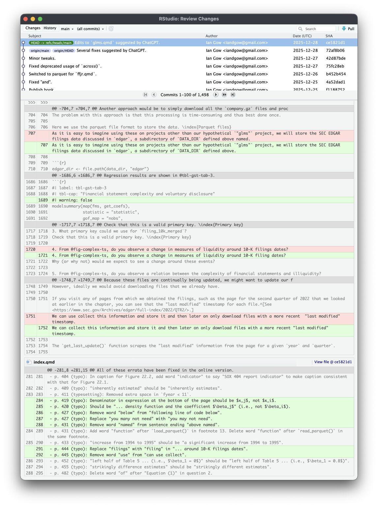

*Originally shared on [LinkedIn](https://www.linkedin.com/posts/iangow_chatgpt-is-a-pretty-awesome-copy-editor-activity-7417619120126558208-PeGb) on 2026-01-15 (UTC).*

::: {.content-visible when-format="html"}
[Download the PDF](chatgpt-copy-editing-git.pdf).
:::

ChatGPT is a pretty awesome copy editor (I guess other AIs are too). It picks up not only typos, but even issues in code and inconsistencies in data-handling. At times it is too willing to say "here is revised text …", but then you tell it that you want notes and feedback, not edited text.

It also works very nicely with Git. Git is such a great tool for complex writing projects (e.g., a book or paper with a lot of code) and is nicely integrated into RStudio. Though there is a bit of a learning curve, especially for "off label" use cases. 

(The screenshot below shows things mostly caught by ChatGPT ... it also found two [fortunately very minor] errors in my code.)

::: {.content-visible when-format="html"}
{width=85%}
:::

## Follow-up comment

*15 January 2026*

The two coding errors I mentioned are discussed here: https://iangow.github.io/far_book/#sec-fixes

They are the ones on p. 257 and on p. 382 of the printed book.

::: {.callout-note icon=false}
## Link update - 9 November 2026

The book’s errata have moved to [Corrections and updates](https://iangow.github.io/far_book/corrections.html#sec-errata). The original link above still points readers there. The comment records the assessment at the time of the original post; the maintained errata now describe the corrections and their effects in more detail.
:::

::: {.content-visible when-format="typst"}


{width=85%}
:::
