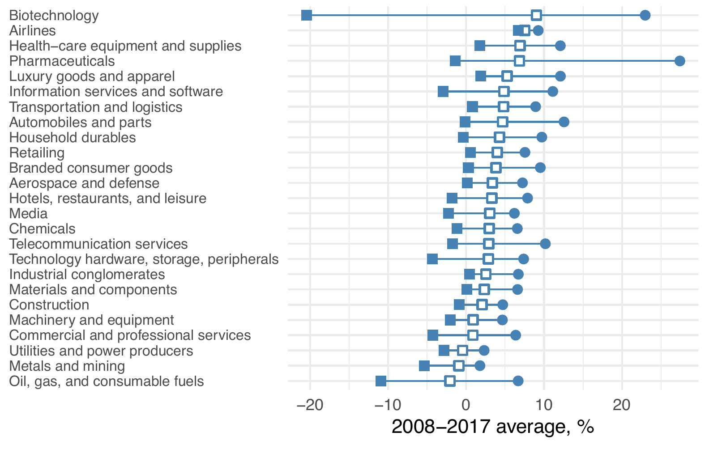

*First published as a note attached to my [LinkedIn post of 10 April 2025](https://www.linkedin.com/posts/iangow_growth-by-industry-activity-7316190330632953857-BE7R). This page retains the original figure; the [original PDF](../growth.pdf) is also available.*

I was reading my copy of the 7th edition of *Valuation: Measuring and Managing the Value of Companies*, one of the best books on corporate finance out there.
In this note, I attempt to make one of the plots in the book.

@fig-growth-ind is a rough replication of Exhibit 9.1 of @Koller:2020aa [p. 157].
While the numbers do not line up exactly, the broad thrust is similar (e.g., *Biotechnology* has high median growth and the widest dispersion).
I think it is helpful to make it possible for readers to see the choices underlying a plot (and to produce their own version with their own choices).

{#fig-growth-ind fig-alt="Industry distributions of compound annual revenue growth between 2008 and 2017. Biotechnology has the widest interquartile range, extending from about minus 20 to plus 25 percent per year."}

[View the figure at full size](growth/original-chart.png).

Some observations:

- While "Compustat" is listed as a data source in the note to Exhibit 9.1 of @Koller:2020aa, it is not clear what sample restrictions were imposed (e.g., size).
- The industry mapping is not entirely clear. I had ChatGPT [guess](https://chatgpt.com/share/67f82079-ab7c-800b-9448-dcd28f7305f9) a possible mapping. I then cleaned this up a tad and posted it in a [Google Sheets document](https://docs.google.com/spreadsheets/d/1B0YvlXC1Mw7fM8IMLe_DhYh1n1E1Et-3__gi9vZoIwY/edit?usp=sharing). I would probably need to go through carefully "by hand" to check that no firms are inadvertently omitted or put in the wrong industry group.
- I like the way the word "Industry" appears (in **bold**) at the top of the y-axis labels (industries) in Exhibit 9.1 of @Koller:2020aa. I couldn't quite replicate that here.
- I couldn't get the legend seen in Exhibit 9.1 of @Koller:2020aa to look good in @fig-growth-ind.
- I had ChatGPT [help me](https://chatgpt.com/share/67f82079-ab7c-800b-9448-dcd28f7305f9) with the creation of the markers at each quantile.
- Updating @fig-growth-ind to cover different periods is quite easy.
- Other plots in Chapter 9 of @Koller:2020aa might be amenable to creation in the same way.

## Code and data

The [original Quarto source](https://github.com/iangow/notes/blob/main/growth.qmd) contains the R code behind the figure.
It uses local Compustat files at `DATA_DIR/comp/funda.parquet` and `DATA_DIR/comp/company.parquet`, loaded through `farr::load_parquet()`.
The calculation uses the standard `INDL`, `STD`, `C`, and `D` filters on `funda` and firms with `fic == "USA"` in `company`.
It calculates compound annual revenue growth from fiscal 2008 to fiscal 2017---a nine-year interval---and uses DuckDB's approximate quartiles within industries.
Industry assignments give precedence to GICS sub-industry, then industry, then industry-group matches.

The figure above was extracted from the original PDF rather than recomputed for this page.
Running the calculation with today's local data and the live mapping produces different numbers.
A [snapshot of the mapping captured on 25 October 2026](growth/industry_mapping.csv) is supplied for inspection; it is not a verified snapshot of the mapping as it stood in April 2025.

There are further choices to revisit before using the code for a new analysis.
The original code does not explicitly exclude non-positive starting revenue or non-finite growth rates.
Its `pivot_wider()` step can also reduce multiple codes for the same industry and field to a single code.
These details, along with the provisional industry mapping, are part of why I describe the figure as a rough replication.
The [source record](growth/sources.json) documents the archived PDF, figure extraction, and mapping snapshot.
The [Typst source](growth.typ) for this version is also available.

::: {#refs}
:::
